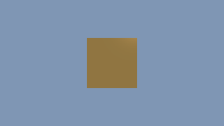
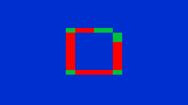

# spectralRayTracer

A small C++20 CPU rendering experiment: eight-ray AVX2 packets, a binned-SAH BVH,
fixed packet seeds and adaptive tile sampling. Despite the repository name and
some legacy spectrum fields, the current image is **RGB** with a heuristic
copper-like material, sky lighting and up to three bounces. This is a reproducible
demo, not a physically validated spectral renderer or sensor simulator. The
broader ideas in `plan` are not implemented contracts.




These captures use generated geometry, 320×180 pixels and a 64-sample budget.
The heatmap shows actual samples per pixel: blue is low effort and red is the
full budget; its 16×8 tile boundaries are intentional.

## Build and run

Requirements: an **x86-64 CPU with AVX2 and FMA**, a C++20 compiler (GCC tested),
GNU Make and POSIX threads. Python 3 is needed for tests; no Python packages,
network calls or model downloads are required by the tests. ARM and CPUs without
these instructions are unsupported; the executable has no runtime CPU dispatch.

```sh
make clean
make -j2
./spectral_tracer --help
./spectral_tracer --mesh orc.stl --output output/smoke.ppm --width 64 --height 36 --samples 4
./spectral_tracer --mesh orc.stl --output output/normal.ppm --width 320 --height 180 --samples 64
./spectral_tracer --mesh orc.stl --output output/heatmap.ppm --width 320 --height 180 --samples 64 --heatmap
```

Run from the repository root or supply your own mesh path. Outputs are text PPM
(P3 RGB, 0–255); use any PPM-capable image viewer. Output parent directories are
created automatically. Build outputs and `output/` are ignored; checked-in binary
and profiling artifacts have been removed so builds use source.

| Option | Default | Contract |
| --- | --- | --- |
| `--mesh PATH` | `orc.stl` | Nonempty little-endian binary STL, at most 10 million triangles; exact file size, finite bounded coordinates and nondegenerate triangles required |
| `--output PATH` | `output/image.ppm` | Writable PPM destination; existing file is replaced |
| `--width N` | `640` | Integer 1–8192 |
| `--height N` | `360` | Integer 1–8192; width × height at most 16,777,216 |
| `--samples N` | `64` | Integer 1–65535; maximum per-pixel budget, not guaranteed sample count |
| `--heatmap` | off | Write sample effort instead of RGB |

The renderer takes `min(4, budget)` pilot samples, then chooses a tile target of
4, 16 or 64, capped by the budget. Sky tiles retain their pilot samples. A budget
above 64 currently adds no quality: the existing heuristic stops at 64. Variance
is estimated across the tile's pilot image, not a per-pixel statistical error
bound. Automatic worker count is capped by image height. Partial tiles and ray
packets are supported, including 1×1 images.

Mesh normals are recomputed from vertex winding. The existing fixed scene setup
rotates meshes −90° around X; the camera remains at `(0, 30, 50)` looking along
−Z, with no automatic framing or scale adjustment. Other meshes may be outside
the frame. Supplied STL asset provenance/licensing is not established here;
the acceptance tests and README captures use synthetic geometry.

## Offline checks

```sh
make test
```

This builds and runs the actual AVX2 implementation, with:

- Synthetic triangle intersections: hits, misses, inactive lanes, parallel rays,
  closer prior hits, vertex hits and back faces; untouched hit records stay intact.
- A planar multi-leaf BVH compared with direct intersection, plus 256 deterministic
  ray lanes compared with brute-force traversal under a mixed active mask.
- Display lower/upper clamping, gamma conversion and non-finite input rejection.
- Real synthetic STL renders at 35×19 and budgets 1, 2, 4, 5, 17 and 65; dimensions,
  channel count/range, finite accumulation, budget bounds and byte-identical reruns.
- A heatmap and a 1×1 render; 19 malformed-option, invalid-mesh or output-failure cases.

The smoke script uses a temporary directory and removes its outputs. To retain
synthetic examples without editing source:

```sh
mkdir -p output/examples
python3 -c 'from pathlib import Path; from tests.smoke import synthetic_mesh; synthetic_mesh(Path("output/examples/synthetic.stl"))'
./spectral_tracer --mesh output/examples/synthetic.stl --output output/examples/normal.ppm --width 320 --height 180 --samples 64
./spectral_tracer --mesh output/examples/synthetic.stl --output output/examples/heatmap.ppm --width 320 --height 180 --samples 64 --heatmap
```

Make writes `.d` header dependencies using `-MMD -MP`. After an initial build,
`touch core_types.h && make` must recompile `main.cpp` and relink; the next `make`
is a no-op. Both behaviors were checked.

Verified on 2026-11-06: Linux, AMD Ryzen 5 3600 (AVX2/FMA), GCC 16.2.1,
`make clean`, `make test`, the header rebuild check, and normal/heatmap renders
of the supplied orc mesh and synthetic square at 320×180/64. Both pairs were
visually inspected. The orc image retains visible low-sample noise/specular
artifacts; the heatmap correctly highlights geometry and tile boundaries.

## Limits

Fixed packet seeds reproduce bytes on the tested executable/hardware, independent
of thread scheduling. Bitwise identity across compilers, CPU architectures or
changed floating-point flags is not promised. Avoid `-ffast-math`. Rendering fails
explicitly on non-finite accumulated values rather than silently encoding them.

RGB shading, approximate gamma-2 display encoding, fixed ray epsilon, short path
length, rough reflections and adaptive thresholds are demonstration choices.
There is no spectral integration, calibrated sensor, energy-conservation claim,
reference-image accuracy claim, GUI or GPU backend. Very large scenes need
substantial memory; the BVH uses a fixed 64-entry traversal stack and is not
hardened for adversarial geometry. Windows/macOS builds have not been verified.
